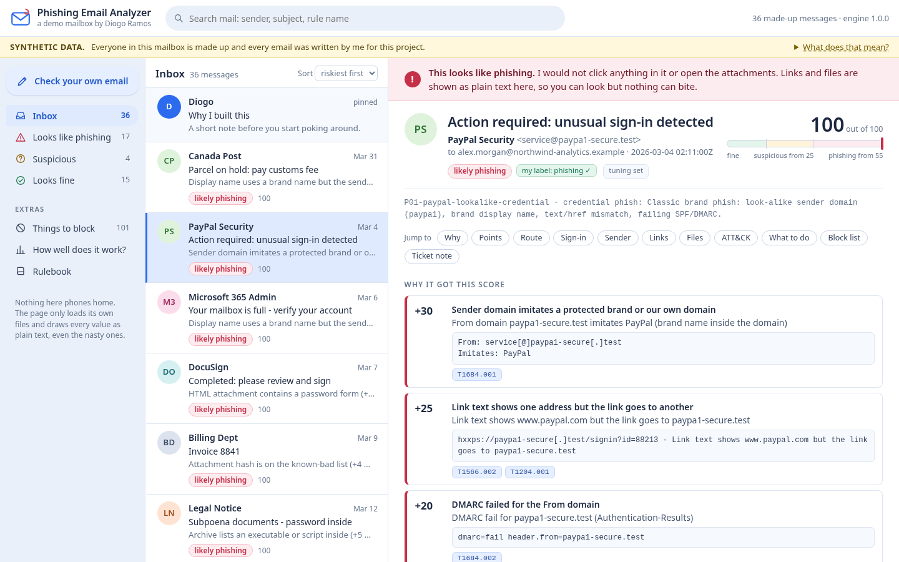
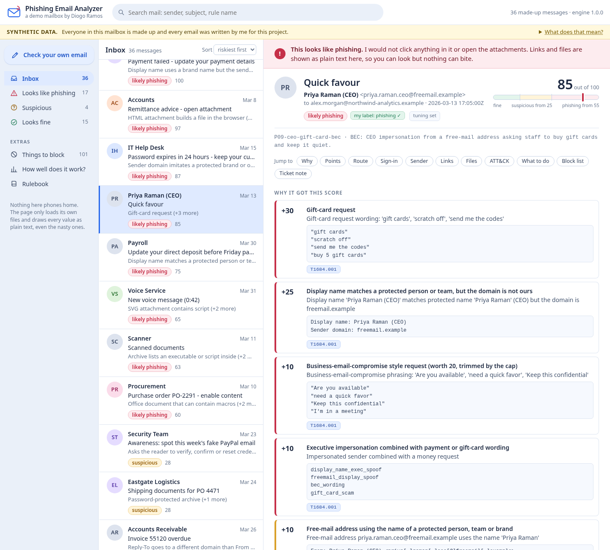
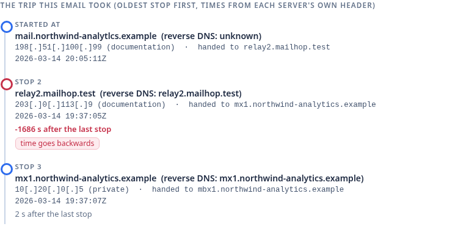
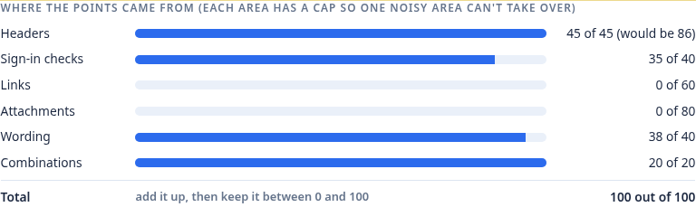
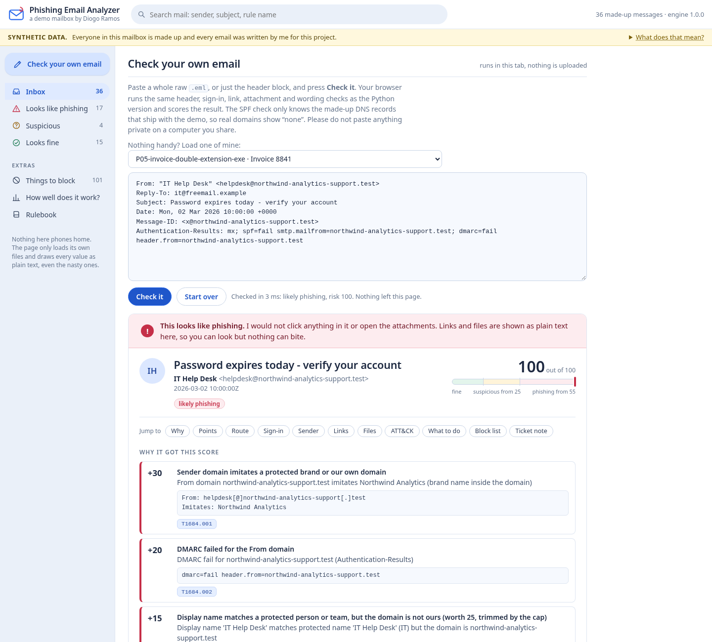
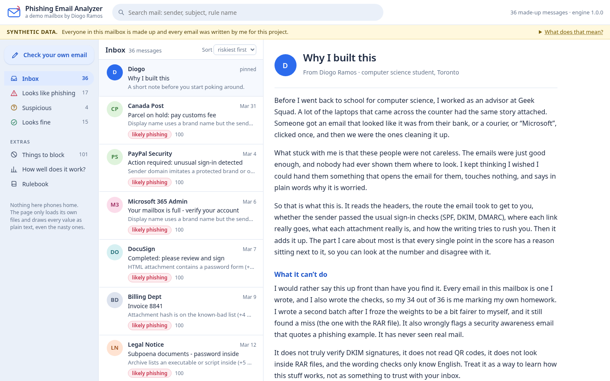
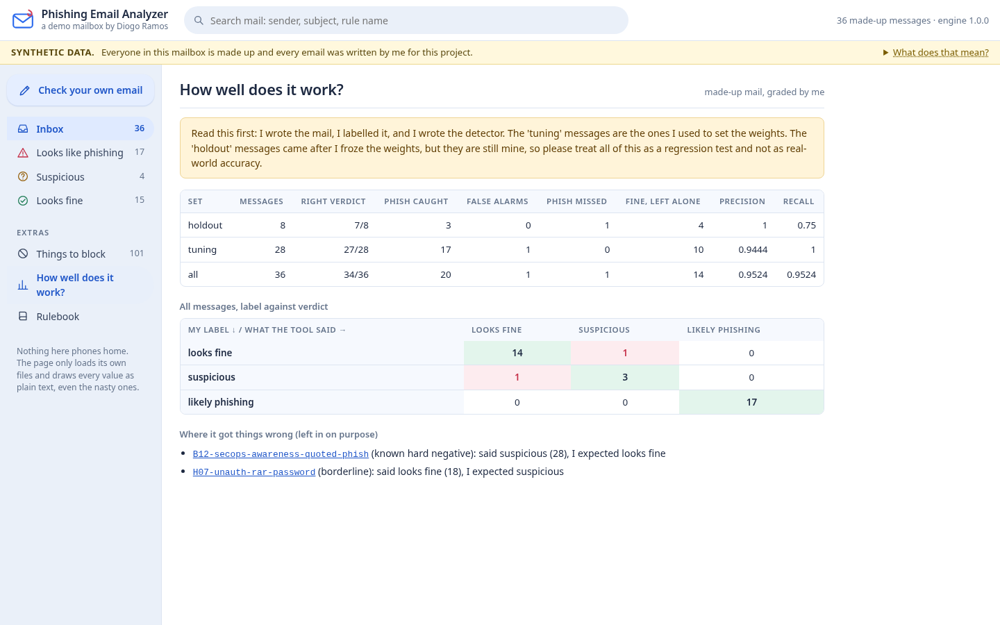
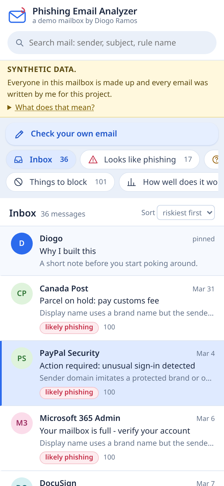
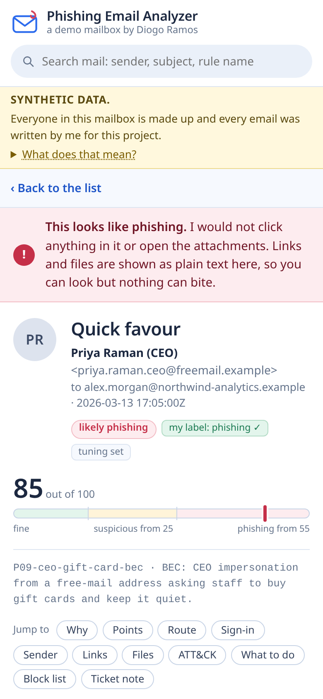
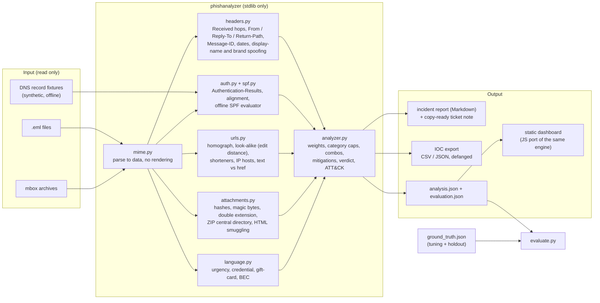

# Phishing Email Analyzer

I built this to answer a question I got asked all the time when I worked at Geek Squad: "is this email safe to open?" It is a Python 3 tool (standard library only) that reads `.eml` files and mbox archives, looks at them **without opening, running or fetching anything**, and gives each message a **0 to 100 risk score with a reason for every point**, a verdict (*benign*, *suspicious* or *likely phishing*), the matching **MITRE ATT&CK** techniques, some suggested next steps, a **defanged IOC export** (CSV and JSON) and a **one-page incident report** with a note you can paste straight into a ticket.

There is also a small dashboard that is set up like a webmail inbox: folders on the left, the message list in the middle, and a reading pane that shows the verdict first, the way a mail client puts a warning banner over a suspicious message. It is light and plain on purpose, has no build step, and has a box where you can paste your own raw email and check it in the browser.

- **Headers:** I follow the Received chain hop by hop (time going backwards, long delays, HELO name vs reverse DNS), compare From, Reply-To and Return-Path, look at the Message-ID and the dates, and catch display-name spoofing (brands, protected people and teams, an email address hiding inside the display name).
- **Sign-in checks:** SPF, DKIM and DMARC are read from `Authentication-Results` (or `Received-SPF`) and checked for alignment with the From domain. There is also an **offline SPF evaluator** (ip4, ip6, a, mx, include, exists, redirect, and the 10-lookup limit) that reads *made-up DNS record fixtures* and never makes a DNS query.
- **Links:** pulled from text and HTML. I check for punycode and homograph tricks, look-alike domains (edit distance plus confusable characters) against a brand list, URL shorteners, IP-address hosts (including decimal, hex and octal ones), link text that does not match the real `href`, odd TLDs, `user@host` tricks and redirect-style parameters.
- **Attachments:** hashes, magic bytes vs file extension, double extensions, right-to-left override characters, macro-enabled Office types, archives that contain executables (I only read the ZIP central directory), password-protected ZIPs and "the password is..." hints, HTML smuggling and SVG scripts, PDF active content, and a known-bad hash list. **Nothing is ever executed, opened, extracted or fetched.**
- **Wording:** urgency, credential and payment lures, gift-card scams, business-email-compromise phrasing, "enable macros" instructions, QR code wording.
- **Scoring:** 63 indicators with whole-number weights, a cap per category, a few combination bonuses and some mitigations (authenticated and aligned, `List-Unsubscribe`). Every point shows up in the output next to its evidence.

> **All the sample data is SYNTHETIC.** The 36 messages in `data/synthetic/` are generated by `phishanalyzer/synthetic.py` and each one has an `X-Synthetic-Sample: yes` header. The company and people are made up, the sender and link domains are reserved ones (`example.*`, `.test`, `.invalid`), and the IP addresses are RFC 5737 documentation ranges (or private ranges). The only real domains are `paypal.com`, `amazon.com` and `aws.amazon.com`, and they are only there as the honest side of look-alike and must-not-flag tests (nothing is ever fetched). Attachments are harmless text stubs with magic bytes only, and the "known-bad" hash is the hash of one of those stubs. The tool has **never been run on real mail**, and every number below is about this made-up set only.

**Live demo (synthetic data):** https://phishing-email-analyzer-nine.vercel.app  |  **Repo:** https://github.com/SomarGuy/phishing-email-analyzer

## The problem

Before I went back to school for computer science in Toronto, I worked as an advisor at Geek Squad, and a lot of what came across the counter was somebody who had clicked a link in an email that looked fine. Help desks and small security teams get the same question over and over: is this safe? Answering it properly means reading the raw headers (does the first public hop match the sender? does the sign-in result line up with the From domain?), working out where each link really goes, checking what an attachment really is, and then writing it all into a ticket so the next person can act on it.

I wanted to understand what a tool that does this is actually doing. How is a Received chain read? Why can SPF pass for a message that is still spoofed (that is alignment)? How do you catch `paypa1`, `micrоsoft` with a Cyrillic *о*, and `docusgn-mail`? How do you look inside a password-protected ZIP without opening it? And how do you turn a pile of weak signals into one score that a person can *argue with*, because every point has a stated reason? I also ported the same engine to JavaScript, so a header block can be checked in the browser without sending it anywhere. The dashboard has a short "Why I built this" note from me too.

## What it does

- **Explains every point.** Each indicator has a weight, a severity, evidence lines and an ATT&CK technique. The score breakdown shows raw and capped points per category, so you can see *why* a message is 87 and not 40.
- **Leaves unusual-but-legitimate mail alone.** The corpus includes a newsletter sent through an email service provider, an HR "urgent" notice, a SaaS password reset, a shop receipt, a no-Message-ID monitoring alert, a legitimate IDN domain (`münchen`), an event QR ticket, a courier short link, a mailing-list digest and a real-brand sub-domain. All of them have to score *benign*. Authenticated, aligned mail gets a bounded discount, but **not** when the sender identity itself looks spoofed.
- **Static only.** MIME is parsed as data. Archives are read through their central directory (entry bytes are never read, and a test makes `ZipFile.read/open/extractall` raise). HTML is tokenised, never rendered. URLs are parsed as strings. There is no DNS, HTTP or file access beyond the input.
- **Defangs its output by default.** `hxxps://evil[.]test/login`, `user[@]example[.]com`, and every IOC domain or IP is also defanged inside free text (ticket notes) so chat and ticket tools do not auto-link it. CSV cells that start with `=`, `+`, `-` or `@` get a `'` in front so a hostile attachment name cannot turn into a spreadsheet formula.
- **Writes help-desk output.** One Markdown incident report per message (verdict, why, response steps, IOCs) ending in a plain-text **ticket note** you can paste into a ticket. `--fail-on` makes the command-line tool usable in a pipeline.
- **Two engines, one behaviour.** The browser version is a hand-written JavaScript port of the same parsing and scoring. `tests/test_js_parity.py` runs both on the whole corpus and on some nasty edge cases, and requires identical indicators, scores, URLs, hops, IOCs and ticket notes.
- **Grades itself** against `ground_truth.json`, with a tuning set (used to set the weights) and a **holdout I wrote after the weights were frozen**. The misses stay in and get reported (see the evaluation section).

## Screenshots

These are real screenshots from headless Chrome, taken by `scripts/dashboard_smoke.js`, which also checks that the page behaves.

**The inbox: folders, message list with sender initials and verdict chips, and the reading pane with its warning banner and score gauge**


**One message opened up: why a CEO gift-card email scores 85**


**The route an email took, with a stop where the timestamps go backwards**


**Where the points came from, per area (raw vs capped)**


**Check your own email: paste a header block or a raw `.eml` and it is analysed in the browser (nothing is uploaded)**


**A note from me, pinned at the top of the inbox**


**How well does it work? The honest numbers, with the misses left in**


**On a phone the list and the message take turns, like a mail app**



**Live deployment**


## Architecture



The weights live in `config/phish_config.json`, not in the code. Each indicator has an id, category, weight, severity, ATT&CK ids, a description and response steps, and `validate-config` checks the file (unknown categories, duplicate ids, a positive weight on a mitigation, an ATT&CK id without a name, a bad regular expression). The scoring rule: add up the indicator weights per category, cap each category (**header 45, auth 40, url 60, attachment 80, language 40, combo 20**), add the three combination indicators, subtract mitigations (at most 20), and clamp the result to 0-100. **25 and up is suspicious, 55 and up is likely phishing.** When a cap trims a category, each indicator's displayed points are scaled down so the list still adds up.

## How to run it

```bash
python -m venv .venv                      # Python 3.10+; the tool itself needs no packages
# Windows (PowerShell):  .venv\Scripts\Activate.ps1     Linux/macOS:  source .venv/bin/activate
pip install -r requirements-dev.txt       # pytest + pytest-cov, for the tests only

python -m phishanalyzer demo              # regenerate the synthetic corpus, analyse it, evaluate it, refresh reports/ and dashboard/data/

python -m phishanalyzer analyze data/synthetic/eml --dns data/synthetic/dns_fixtures.json
python -m phishanalyzer analyze data/synthetic/corpus.mbox --out out/ --fail-on phishing     # exit status 2 if anything is likely phishing
python -m phishanalyzer analyze suspicious.eml --json                                         # full result as JSON
python -m phishanalyzer explain data/synthetic/eml/P11-helpdesk-password-reset-spoof.eml --dns data/synthetic/dns_fixtures.json
python -m phishanalyzer evaluate data/synthetic/eml --truth data/synthetic/ground_truth.json --dns data/synthetic/dns_fixtures.json
python -m phishanalyzer list-indicators   # every indicator with weight and ATT&CK mapping
python -m phishanalyzer validate-config config/phish_config.json
python -m phishanalyzer generate --out data/synthetic

python -m http.server 8000 --directory dashboard      # dashboard at http://localhost:8000
python -m pytest                                      # tests (python -m pytest --cov=phishanalyzer for coverage)
```

Exit status: `0` is ok, `1` is an error (bad input or config), `2` means a `--fail-on` threshold was reached or the command line was wrong. `analyze --out DIR` writes `analysis.json`, `analysis.md`, `iocs.csv`, `iocs.json` and `incidents/<message>.md`. Only pass `--dns` with the made-up fixtures: the offline SPF evaluator uses a message's first public Received hop and its Return-Path domain, and only when the message has no SPF result of its own.

To run the browser check and take the screenshots yourself (needs Node, `playwright-core` and a Chrome or Chromium install):

```bash
python -m http.server 8077 --directory dashboard &
npm i playwright-core
CHROME=/usr/bin/google-chrome node scripts/dashboard_smoke.js http://127.0.0.1:8077 screenshots
```

## Sample output

This is what the command line prints for the whole corpus:

`python -m phishanalyzer analyze data/synthetic/eml --dns data/synthetic/dns_fixtures.json`

```
MESSAGE                                      SCORE  VERDICT          TOP INDICATORS
B01-newsletter-harbour-gazette                   0  BENIGN           -
B02-internal-finance-approvals                   0  BENIGN           -
B03-hr-benefits-deadline                         0  BENIGN           urgency_language
B04-saas-password-reset                          8  BENIGN           credential_lure, urgency_language
B05-shop-order-receipt                           0  BENIGN           payment_lure
B06-monitoring-alert-no-msgid                    0  BENIGN           message_id_missing
B07-events-idn-muenchen                          0  BENIGN           -
B08-event-ticket-qr                              3  BENIGN           qr_lure
B09-courier-parcel-shortlink                     0  BENIGN           url_shortener
B10-mailing-list-digest                          0  BENIGN           -
B12-secops-awareness-quoted-phish               28  SUSPICIOUS       credential_lure, url_brand_in_domain, url_login_keywords
H01-saas-billing-receipt-esp                     0  BENIGN           payment_lure
H02-newsletter-unicode-cafe                      0  BENIGN           generic_greeting
H03-internal-maintenance-notice                  0  BENIGN           -
H04-payroll-direct-deposit-change               75  LIKELY PHISHING  display_name_exec_spoof, reply_to_mismatch, payment_lure
H05-voicemail-svg-script                        65  LIKELY PHISHING  svg_script, dmarc_fail, spf_fail
H06-parcel-fee-decimal-ip                      100  LIKELY PHISHING  display_name_brand_spoof, dmarc_fail, url_ip_host
H07-unauth-rar-password                         18  BENIGN           archive_password_hint, auth_absent
H08-aws-billing-brand-on-real-domain             0  BENIGN           -
P01-paypal-lookalike-credential                100  LIKELY PHISHING  sender_domain_lookalike, url_text_mismatch, dmarc_fail
P02-microsoft-idn-homograph                    100  LIKELY PHISHING  display_name_brand_spoof, url_idn_homograph, dmarc_fail
P03-docusign-html-credential-attachment        100  LIKELY PHISHING  html_credential_form, sender_domain_lookalike, dmarc_fail
P04-remittance-html-smuggling                   97  LIKELY PHISHING  html_smuggling, dmarc_fail, spf_fail
P05-invoice-double-extension-exe               100  LIKELY PHISHING  attachment_known_bad, attachment_executable, dmarc_fail
P06-purchase-order-macro-docm                   60  LIKELY PHISHING  attachment_macro, enable_content_lure, payment_lure
P07-scans-zip-with-scr                          63  LIKELY PHISHING  archive_contains_executable, dmarc_fail, spf_softfail
P08-encrypted-zip-exe-password                 100  LIKELY PHISHING  archive_contains_executable, archive_encrypted, dmarc_fail
P09-ceo-gift-card-bec                           85  LIKELY PHISHING  gift_card_scam, display_name_exec_spoof, bec_wording
P10-cfo-vendor-bank-change-lookalike           100  LIKELY PHISHING  sender_domain_lookalike, bec_wording, dmarc_fail
P11-helpdesk-password-reset-spoof               87  LIKELY PHISHING  sender_domain_lookalike, display_name_exec_spoof, credential_lure
P12-mfa-qr-code-phish                          100  LIKELY PHISHING  display_name_brand_spoof, dmarc_fail, qr_lure
P13-amazon-userinfo-ip-url                     100  LIKELY PHISHING  sender_domain_lookalike, url_text_mismatch, url_userinfo
P14-netflix-open-redirect-billing              100  LIKELY PHISHING  display_name_brand_spoof, dmarc_fail, spf_fail
S01-partner-encrypted-zip                       28  SUSPICIOUS       archive_encrypted, archive_password_hint
S02-shared-doc-unauth-shortlink                 25  SUSPICIOUS       credential_lure, url_shortener, auth_absent
S03-unknown-vendor-invoice-reply-to             28  SUSPICIOUS       reply_to_mismatch, payment_lure, auth_absent

36 message(s): 15 benign, 4 suspicious, 17 likely phishing; 101 IOC(s)
```

The ticket note for `P11-helpdesk-password-reset-spoof` (a spoofed "IT Help Desk" password-expiry mail), ready to paste into a ticket. Everything that could be auto-linked is defanged:

```text
PHISHING TRIAGE - LIKELY PHISHING (risk 87/100)
Subject: Password expires in 24 hours - keep your current password
From: "IT Help Desk" <helpdesk[@]northwind-analytics-support[.]test>
Sent: 2026-03-15 07:50:00Z | Origin IP: 203[.]0[.]113[.]240
Authentication: SPF none | DKIM none | DMARC none
Why it was flagged:
  1. Sender domain imitates a protected brand or our own domain (+30) - From domain northwind-analytics-support[.]test imitates Northwind Analytics (brand name inside the domain)
  2. Display name matches a protected person or team, but the domain is not ours (+15) - Display name 'IT Help Desk' matches protected name 'IT Help Desk' (IT) but the domain is northwind-analytics-support[.]test
  3. Asks the reader to verify, confirm or reset credentials (+12) - Credential-harvesting wording: 'Password expire', 'keep your current password', 'Sign in to keep'
  4. Brand name used inside a domain it does not own (+12) - Northwind Analytics used inside the domain northwind-analytics-support[.]test
  5. Urgent or threatening wording (+8) - Pressure/urgency wording: 'within 24 hours', 'within 24 hours'
Suspicious links: hxxps://sso[.]northwind-analytics-support[.]test/login?user=alex.morgan
ATT&CK: T1684.001, T1598.003, T1566.002
Recommended actions:
  [ ] Add the lookalike domain to the mail gateway block list.
  [ ] Confirm any request with the real person or team using a known phone number or chat.
  [ ] Do not click links, open attachments or reply. If the user already did, treat it as an incident (see the steps marked 'if clicked').
  [ ] Report the message to the security team and keep the original (.eml with full headers) as evidence; do not forward it as plain text.
  [ ] Block the sender address and the domains/URLs below at the mail gateway and web proxy, then search other mailboxes for the same sender, subject, URL or attachment hash.
  [ ] If the user clicked or opened anything: reset their password, revoke active sessions, check MFA methods and mailbox rules, and isolate the device if an attachment was opened.
User impact: UNKNOWN - ask the recipient whether they clicked a link, opened an attachment, entered credentials or replied.
Method: phishanalyzer 1.0.0 static analysis (nothing was opened, executed or fetched).
```

`reports/iocs.csv` (first rows; `value` is the raw indicator for blocklists, `defanged` is for sharing):

```
message_id,type,value,defanged,context,verdict,score
B12-secops-awareness-quoted-phish,email,secops@northwind-analytics.example,secops[@]northwind-analytics[.]example,From address,suspicious,28
B12-secops-awareness-quoted-phish,domain,northwind-analytics.example,northwind-analytics[.]example,Sender domain,suspicious,28
B12-secops-awareness-quoted-phish,url,https://paypa1-secure.test/login,hxxps://paypa1-secure[.]test/login,url_brand_in_domain; url_login_keywords,suspicious,28
B12-secops-awareness-quoted-phish,domain,paypa1-secure.test,paypa1-secure[.]test,Domain of a flagged URL,suspicious,28
H04-payroll-direct-deposit-change,email,payroll.dept2026@freemail.example,payroll[.]dept2026[@]freemail[.]example,From address,likely_phishing,75
```

The per-message pages are in `reports/incidents/`, the machine-readable result in `reports/analysis.json`, and the evaluation in `reports/evaluation.md`.

The per-message pages are in `reports/incidents/`, the machine-readable result is `reports/analysis.json`, and the evaluation is `reports/evaluation.md`.

## Indicators

63 indicators in the groups below, each with a weight you can read and change in `config/phish_config.json`. The ATT&CK ids use the sub-technique numbering that was current when I wrote this, see the note under the table.


| Indicator | Category | Weight | Severity | ATT&CK | What it flags |
|---|---|---|---|---|---|
| `sender_domain_lookalike` | header | 30 | high | T1684.001 | Sender domain imitates a protected brand or our own domain |
| `display_name_brand_spoof` | header | 25 | high | T1684.001 | Display name uses a brand name but the sender domain is not that brand's |
| `display_name_email_spoof` | header | 25 | high | T1684.001 | Display name contains a different email address than the real sender |
| `display_name_exec_spoof` | header | 25 | high | T1684.001 | Display name matches a protected person or team, but the domain is not ours |
| `reply_to_mismatch` | header | 15 | medium | T1684.002 | Reply-To goes to a different domain than From |
| `freemail_display_spoof` | header | 10 | medium | T1566.003, T1684.001 | Free-mail address using the name of a protected person, team or brand |
| `received_time_anomaly` | header | 10 | medium | - | Received timestamps go backwards or show a very long delay |
| `return_path_mismatch` | header | 10 | low | T1684.002 | Return-Path (envelope sender) domain differs from From and nothing aligned vouches for it |
| `date_future` | header | 8 | low | - | Date header is later than the time the mail was delivered |
| `received_helo_mismatch` | header | 6 | low | - | Origin hop's HELO name does not match its reverse DNS |
| `received_missing` | header | 6 | low | - | No Received headers |
| `date_invalid` | header | 5 | low | - | Date header missing or unparseable |
| `date_stale` | header | 5 | low | - | Date header is much older than the first delivery hop |
| `message_id_domain_mismatch` | header | 5 | low | - | Message-ID domain is unrelated to the sender |
| `message_id_malformed` | header | 5 | low | - | Message-ID is malformed |
| `message_id_missing` | header | 5 | low | - | No Message-ID header |
| `received_many_hops` | header | 3 | low | - | Unusually long Received chain |
| `dmarc_fail` | auth | 20 | high | T1684.002 | DMARC failed for the From domain |
| `spf_fail` | auth | 15 | high | T1684.002 | SPF failed: the sending server is not authorised for the envelope domain |
| `dkim_fail` | auth | 12 | high | T1684.002 | DKIM signature failed verification |
| `spf_softfail` | auth | 8 | medium | T1684.002 | SPF softfail |
| `dkim_misaligned` | auth | 4 | low | - | DKIM passed but for a different domain than From |
| `auth_absent` | auth | 3 | low | - | No SPF, DKIM or DMARC results available |
| `url_lookalike_domain` | url | 30 | high | T1566.002, T1204.001, T1598.003 | Link domain imitates a brand or our own domain |
| `url_idn_homograph` | url | 25 | high | T1566.002, T1204.001 | Link uses look-alike (homograph) characters |
| `url_text_mismatch` | url | 25 | high | T1566.002, T1204.001 | Link text shows one address but the link goes to another |
| `url_userinfo` | url | 25 | high | T1566.002, T1204.001 | Link contains user@ credentials syntax that hides the real host |
| `url_ip_host` | url | 20 | high | T1566.002, T1204.001 | Link points to a raw IP address |
| `url_script_scheme` | url | 20 | high | T1566.002, T1204.001 | Link uses a javascript: or data: scheme |
| `url_brand_in_subdomain` | url | 15 | medium | T1566.002 | Brand domain appears as a subdomain of someone else's domain |
| `url_brand_in_domain` | url | 12 | medium | T1566.002, T1598.003 | Brand name used inside a domain it does not own |
| `url_redirect_param` | url | 10 | medium | T1566.002 | Link carries a redirect parameter to a different site |
| `url_shortener` | url | 10 | medium | T1566.002 | Link goes through a URL shortener |
| `url_suspicious_tld` | url | 8 | low | T1566.002 | Link uses a top-level domain often abused for phishing |
| `url_login_keywords` | url | 6 | low | T1598.003 | Login/verify wording in a link to an unrelated domain |
| `url_obfuscated` | url | 5 | low | T1566.002 | Very long or deeply nested link |
| `attachment_known_bad` | attachment | 60 | critical | T1566.001, T1204.002 | Attachment hash is on the known-bad list |
| `html_smuggling` | attachment | 40 | high | T1566.001, T1027.006 | HTML attachment builds a file in the browser (HTML smuggling) |
| `archive_contains_executable` | attachment | 35 | high | T1566.001, T1204.002 | Archive lists an executable or script inside |
| `attachment_executable` | attachment | 35 | high | T1566.001, T1204.002 | Attachment is an executable or script type |
| `attachment_rtl_override` | attachment | 35 | high | T1566.001, T1036.002 | File name contains a right-to-left override character |
| `html_credential_form` | attachment | 35 | high | T1566.001, T1598.003 | HTML attachment contains a password form |
| `attachment_double_extension` | attachment | 30 | high | T1566.001, T1036.007 | Attachment has a double extension (document name, executable type) |
| `attachment_macro` | attachment | 30 | high | T1566.001, T1204.002 | Office document that can contain macros |
| `svg_script` | attachment | 30 | high | T1566.001, T1027.017 | SVG attachment contains script |
| `archive_encrypted` | attachment | 25 | medium | T1566.001 | Password-protected archive |
| `attachment_magic_mismatch` | attachment | 25 | high | T1566.001, T1036.008 | Attachment content does not match its file extension |
| `pdf_active_content` | attachment | 20 | medium | T1566.001 | PDF contains JavaScript or launch actions |
| `archive_password_hint` | attachment | 15 | medium | T1566.001 | Message body gives a password for the attached archive |
| `html_attachment` | attachment | 12 | medium | T1566.001 | HTML or SVG file attached |
| `gift_card_scam` | language | 30 | high | T1684.001 | Gift-card request |
| `bec_wording` | language | 20 | high | T1684.001 | Business-email-compromise style request |
| `enable_content_lure` | language | 20 | high | T1204.002 | Asks the reader to 'enable content' or macros |
| `qr_lure` | language | 15 | medium | T1566.002 | Asks the reader to scan a QR code |
| `credential_lure` | language | 12 | medium | T1598.003 | Asks the reader to verify, confirm or reset credentials |
| `payment_lure` | language | 10 | medium | - | Invoice, payment or bank-detail wording |
| `urgency_language` | language | 8 | low | - | Urgent or threatening wording |
| `generic_greeting` | language | 3 | low | - | Generic greeting ("Dear customer") |
| `combo_exec_payment` | combo | 10 | high | T1684.001 | Executive impersonation combined with payment or gift-card wording |
| `combo_lure_deceptive_link` | combo | 10 | high | T1598.003 | Credential or urgency lure combined with a deceptive link |
| `combo_unauth_spoof` | combo | 10 | high | T1684.002 | Claims a protected identity and fails authentication |
| `authenticated_aligned` | mitigation | -12 | info | - | Sender domain authenticated and aligned (DMARC pass, or aligned DKIM or SPF pass) |
| `list_unsubscribe` | mitigation | -5 | info | - | Has a List-Unsubscribe header |


**ATT&CK note.** In ATT&CK v20, *Impersonation* and *Email Spoofing* sit under a new *Social Engineering* technique as **T1684.001** and **T1684.002**; older write-ups use T1656 (Impersonation) and T1672 (Email Spoofing), so you may see those ids elsewhere. I used the new ids; `config/phish_config.json` has the names, so a change is one edit. The phishing sub-techniques used are T1566.001 (attachment), T1566.002 (link) and T1566.003 (via service), plus T1598.003 for credential-harvesting links, T1204.001 / .002 for user execution, T1027.006 / .017 for HTML and SVG smuggling and T1036.002 / .007 / .008 for masquerading.

## The synthetic corpus

36 labelled messages, all written by me, in two sets. The **tuning** set (28 messages) is what I was looking at while I chose the weights. The **holdout** (8 messages, ids starting with `H`) was written *after* the weights were frozen and I did not use it to change anything. Between them they cover ordinary newsletters and legitimate-but-odd mail (which must not be flagged), generic phish, business email compromise (gift card, payroll, CFO bank change), malicious attachments (a double-extension executable, a macro document, a ZIP with a `.scr` inside, an encrypted ZIP, HTML smuggling, an SVG with a script), QR and look-alike URLs, and a spoofed IT help-desk password reset.


| Message | Set | Category | Label | Score | Verdict | Correct |
|---|---|---|---|---|---|---|
| `B01-newsletter-harbour-gazette` | tuning | newsletter | benign | 0 | benign | yes |
| `B02-internal-finance-approvals` | tuning | internal | benign | 0 | benign | yes |
| `B03-hr-benefits-deadline` | tuning | internal | benign | 0 | benign | yes |
| `B04-saas-password-reset` | tuning | legit password reset | benign | 8 | benign | yes |
| `B05-shop-order-receipt` | tuning | receipt | benign | 0 | benign | yes |
| `B06-monitoring-alert-no-msgid` | tuning | legit but weird | benign | 0 | benign | yes |
| `B07-events-idn-muenchen` | tuning | legit IDN | benign | 0 | benign | yes |
| `B08-event-ticket-qr` | tuning | legit QR | benign | 3 | benign | yes |
| `B09-courier-parcel-shortlink` | tuning | legit shortener | benign | 0 | benign | yes |
| `B10-mailing-list-digest` | tuning | legit but weird | benign | 0 | benign | yes |
| `B12-secops-awareness-quoted-phish` | tuning | known hard negative | benign | 28 | suspicious | **no** |
| `S01-partner-encrypted-zip` | tuning | borderline | suspicious | 28 | suspicious | yes |
| `S02-shared-doc-unauth-shortlink` | tuning | borderline | suspicious | 25 | suspicious | yes |
| `S03-unknown-vendor-invoice-reply-to` | tuning | borderline | suspicious | 28 | suspicious | yes |
| `P01-paypal-lookalike-credential` | tuning | credential phish | phishing | 100 | likely phishing | yes |
| `P02-microsoft-idn-homograph` | tuning | homograph | phishing | 100 | likely phishing | yes |
| `P03-docusign-html-credential-attachment` | tuning | malicious attachment | phishing | 100 | likely phishing | yes |
| `P04-remittance-html-smuggling` | tuning | malicious attachment | phishing | 97 | likely phishing | yes |
| `P05-invoice-double-extension-exe` | tuning | malicious attachment | phishing | 100 | likely phishing | yes |
| `P06-purchase-order-macro-docm` | tuning | malicious attachment | phishing | 60 | likely phishing | yes |
| `P07-scans-zip-with-scr` | tuning | malicious attachment | phishing | 63 | likely phishing | yes |
| `P08-encrypted-zip-exe-password` | tuning | malicious attachment | phishing | 100 | likely phishing | yes |
| `P09-ceo-gift-card-bec` | tuning | BEC | phishing | 85 | likely phishing | yes |
| `P10-cfo-vendor-bank-change-lookalike` | tuning | BEC | phishing | 100 | likely phishing | yes |
| `P11-helpdesk-password-reset-spoof` | tuning | credential phish | phishing | 87 | likely phishing | yes |
| `P12-mfa-qr-code-phish` | tuning | QR phish | phishing | 100 | likely phishing | yes |
| `P13-amazon-userinfo-ip-url` | tuning | URL trick | phishing | 100 | likely phishing | yes |
| `P14-netflix-open-redirect-billing` | tuning | credential phish | phishing | 100 | likely phishing | yes |
| `H01-saas-billing-receipt-esp` | holdout | receipt | benign | 0 | benign | yes |
| `H02-newsletter-unicode-cafe` | holdout | legit IDN | benign | 0 | benign | yes |
| `H03-internal-maintenance-notice` | holdout | internal | benign | 0 | benign | yes |
| `H04-payroll-direct-deposit-change` | holdout | BEC | phishing | 75 | likely phishing | yes |
| `H05-voicemail-svg-script` | holdout | malicious attachment | phishing | 65 | likely phishing | yes |
| `H06-parcel-fee-decimal-ip` | holdout | URL trick | phishing | 100 | likely phishing | yes |
| `H07-unauth-rar-password` | holdout | borderline | suspicious | 18 | benign | **no** |

There is no `B11`, the numbering just skips it. The generated files are in `data/synthetic/eml/`, the same messages as one `corpus.mbox`, `dns_fixtures.json` for the offline SPF, and `ground_truth.json`, which has `expect` (indicators that must fire) and `forbid` (indicators that must not score) for every message.

## Evaluation against ground truth

`python -m phishanalyzer evaluate data/synthetic/eml --truth data/synthetic/ground_truth.json --dns data/synthetic/dns_fixtures.json`


| Set | Messages | Exact verdict | TP | FP | FN | TN | Precision | Recall | Expected indicators | Forbidden hits |
|---|---|---|---|---|---|---|---|---|---|---|
| tuning | 28 | 27/28 | 17 | 1 | 0 | 10 | 0.9444 | 1.0 | 55/55 | 0 |
| holdout | 8 | 7/8 | 3 | 0 | 1 | 4 | 1.0 | 0.75 | 9/9 | 0 |
| all | 36 | 34/36 | 20 | 1 | 1 | 14 | 0.9524 | 0.9524 | 64/64 | 0 |

Confusion matrix (all 36 messages, rows are the label I assigned):

| truth \ verdict | benign | suspicious | likely phishing |
|---|---|---|---|
| benign | 14 | 1 | 0 |
| suspicious | 1 | 3 | 0 |
| likely phishing | 0 | 0 | 17 |

**Read this with the following caveat.** The corpus, its labels and the detector were all written by the same person, so this is a **self-graded** test. It shows that the heuristics do what I wrote them to do on messages I designed; it is **not** an estimate of how the tool would perform on real mail. The holdout was written after the weights were frozen, which makes it a fairer check than the tuning set, but I wrote the holdout knowing how the detector works, so it is still optimistic.

**Please read this part.** I wrote the corpus, I wrote the labels and I wrote the detector, so this is a **self-graded** test. It shows the heuristics do what I built them to do on messages I designed. It is **not** an estimate of how the tool would do on real mail. The holdout was written after the weights were frozen, which makes it fairer than the tuning set, but I wrote it knowing how the detector works, so it is still a bit optimistic.

Two results are left in on purpose:

- **`B12-secops-awareness-quoted-phish` is a false positive** (score 28, *suspicious*, labelled benign). A security-awareness email from the real security team quotes an example phishing message with a look-alike link. A scorer that only looks at content cannot tell "describing a phish" from "being one" when the link and the wording are the same. It stays *suspicious* instead of *likely phishing* because the email is authenticated and aligned, and I did not tune the weights to hide it.
- **`H07-unauth-rar-password` is a miss** (score 18, *benign*, labelled suspicious). An unauthenticated message with a RAR attachment and "the password is ..." in the body only reaches the *password hint* and *no authentication* indicators, because the tool does not look inside RAR files or check whether the RAR is encrypted. Fixing it means writing a RAR header parser, or raising the weight of a password hint, and that would be tuning on the holdout. So I wrote it down instead.

On the tuning set every expected indicator fired and no forbidden indicator scored, and the holdout is the same. Those checks are weaker than they sound, because I wrote the `expect` lists from what the detector does.

## Project layout


## Project layout

```
phishanalyzer/
  textutil.py        hand-written primitives mirrored in JS: addresses, RFC 2822 dates, HTML tokeniser, URL parser,
                     punycode, scripts / confusables, edit distance, defanging
  mime.py            stdlib e-mail parser -> plain data (headers, text, html, attachments), mbox reader
  headers.py         Received hops, From / Reply-To / Return-Path, Message-ID, dates, brand and display-name logic
  auth.py, spf.py    Authentication-Results / Received-SPF parsing, alignment, offline SPF evaluator
  urls.py            link extraction and per-link analysis
  attachments.py     magic bytes, names, archives (central directory only), HTML / SVG / PDF indicators
  language.py        wording heuristics
  analyzer.py        orchestration, weights, caps, combos, mitigations, verdict
  iocs.py            IOC extraction, CSV / JSON export (defanged, formula-safe)
  report.py          ticket note, incident report, summaries
  evaluate.py        compare results with ground_truth.json
  synthbuild.py      deterministic MIME builder and inert payloads (including a real ZipCrypto writer)
  synthetic.py       the 36-message corpus, DNS fixtures and ground truth
  inputs.py, cli.py  file / directory / mbox input; command line
config/phish_config.json      indicators, weights, caps, brands, lists, language patterns, ATT&CK names
data/synthetic/               eml/, corpus.mbox, dns_fixtures.json, ground_truth.json (labelled SYNTHETIC)
reports/                      analysis.json/.md, evaluation.json/.md, iocs.csv/.json, incidents/*.md
dashboard/                    static site: index.html, app.js, core.js + core-text.js (browser port), style.css, data/, vercel.json
tests/                        pytest suite
scripts/dashboard_smoke.js    headless-Chrome check + screenshots (needs playwright-core)
scripts/parity_dump.js        runs the browser engine under Node for the parity tests
```

## Tests

```bash
python -m pytest
python -m pytest --cov=phishanalyzer --cov-report=term-missing
```

**339 pytest tests**, and line coverage of the `phishanalyzer` package is measured at 100% (`pytest-cov`; the few defensive branches that cannot be reached are marked `# pragma: no cover` with a reason). Coverage only shows the code ran, not that it is right, so the tests are built around behaviour:

- every indicator on hand-built messages, both where it should fire and where it should not
- SPF mechanisms (including the lookup limit), cross-checked against the browser evaluator
- each magic-byte signature, double extensions, macros, archives (the tests assert that archive entry data is never read), HTML smuggling
- URL tricks: homograph, userinfo, hex and decimal IPs, redirect parameters, link text that disagrees with the link
- the whole synthetic corpus against its ground truth
- the command line and its exit codes, and mbox and `.eml` directories giving the same answers
- the generator (deterministic, labelled, only reserved domains and documentation IPs), formula-safe CSV
- the committed reports, dashboard data and README numbers, which must match what the code produces today
- the dashboard files: strict CSP, no inline scripts or styles, no `innerHTML`, the three-pane layout and the "Why I built this" note

`tests/test_js_parity.py` and the primitive tests run the **browser engine under Node** and require the same results as Python on the corpus plus crafted headers, URLs, sign-in results and attachments.

A separate script, `scripts/dashboard_smoke.js`, drives the real dashboard in headless Chrome. It checks the folder counts, the sort order, search, the warning banner and gauge, the route list, opening the pinned note, the paste analyser (same verdict and score as Python for a sample, and for header-only input), hostile text staying inert, no requests to anything but its own files, and no sideways scrolling on a phone-sized screen.

## Deploying the dashboard

`dashboard/` is a plain static site with no build step. On Vercel you can import the repository (the root `vercel.json` sets `outputDirectory` to `dashboard`) or deploy the `dashboard/` folder directly. Any static host works. The Content-Security-Policy is `default-src 'self'; script-src 'self'; style-src 'self'`, so there are no inline scripts or styles, and every value is put on the page with `textContent` (a test fails if `innerHTML`, `eval` or an inline handler shows up). Opening `index.html` straight from disk will not load the data, because browsers block `fetch()` on `file://`. Serve it with `python -m http.server` instead. `python -m phishanalyzer demo` regenerates `dashboard/data/`.

## What I learned

- **A passing SPF check does not mean the sender is who they say they are.** Sign-in results only mean something once you compare them with the From domain (alignment). A phisher can send from their own domain with a perfect SPF pass, so "authenticated" should only lower the score when the sender identity is not itself spoofed. I got that rule wrong at first and a spoofed display name ended up looking safer.
- **Look-alike detection is really several problems.** `paypa1` is a character swap, `paypall` is a typo, `secure-paypal-login` is the brand as a word, `docusgn-mail` is a typo of a word, `paypal.com.evil.test` is the brand in a sub-domain, and a Cyrillic *а* in `pаypal` is a script mix. Each one needed its own rule, and the hyphenated company name (`northwind-analytics`) broke my first normaliser.
- **The "don't flag this" tests mattered more than the phishing ones.** Flagging a fake PayPal email is easy. The work was making a real newsletter, a real IDN domain, an HR "urgent" notice, a legitimate brand sub-domain and a mail with no Message-ID *not* score. Several indicators only fire in combination because each one alone is common in normal mail.
- **Tuning on the data you grade is cheating by default.** I added an "enable content" indicator and raised the encrypted-ZIP weights to catch two weak tuning messages, then froze the weights and wrote the holdout. It found one miss (`H07`). Leaving it in, instead of nudging a weight until it passed, was the whole point of having a holdout.
- **Treat mail as hostile input.** File names, display names and URLs are chosen by the attacker. They can carry a right-to-left override, an `=HYPERLINK()` formula that runs when somebody opens the CSV, or a `<script>` tag aimed at a dashboard. Defanging, formula-safe CSV and `textContent` rendering each came from asking "what if this value is the attack?"
- **Two implementations need a referee.** Porting the engine to JavaScript meant writing the basics by hand (date parsing, punycode, URL splitting, IP and CIDR maths, SHA-256) instead of leaning on library behaviour. The parity test that compares every field of every message is what kept the two honest. It caught, for example, a ticket-note line that had drifted between the two versions.

## Limitations

- **Self-graded and synthetic.** See the evaluation section. No real mail was used and I did not compare it with any commercial or open-source filter. The 34/36 figure says nothing about real-world accuracy.
- **Static heuristics only.** Nothing is detonated or looked up: no sandbox, no URL reputation, no WHOIS or domain age, no live DNS, no threat feed. The "known-bad" list holds one made-up stub hash, and the brand, free-mail, shortener and TLD lists are short examples.
- **DKIM is not verified.** `Authentication-Results` is trusted as written (a message from outside your gateway can carry a forged one), and a bare `DKIM-Signature` is reported as *unverified* because checking it needs the public key from DNS. The offline SPF evaluator only uses fixture records, does not do macros or `ptr`, and takes the first public Received hop as the sending IP. That is only safe if you trust the hops below it.
- **QR codes are not decoded.** A QR lure is spotted from the wording plus an image in the message, but the image is never decoded, so a QR code that carries the bad URL is not extracted.
- **Archives.** ZIP is read through the central directory (names, sizes, encryption flag). A RAR or 7z is hashed but its contents are not inspected, and nested or split archives are not followed. This is exactly why `H07` is missed.
- **The wording checks are English-only regular expressions.** They are easy to evade and they misfire on legitimate urgency (the HR and security-awareness cases show both). A generic greeting on its own is a very weak signal.
- **Look-alike detection** allows an edit distance of at most 2 (1 for short names) and uses a small table of confusable characters. It misses homoglyphs that are not in the table and ignores brands that are not in the list.
- **Stand-in config entries.** The brand list includes made-up entries (`northwind-analytics.example` is the organisation), `freemail.example` stands in for a free-mail provider, `short.test` for a URL shortener and `.invalid` for a suspicious TLD, so the corpus can stay on reserved domains.
- **The browser version is a port.** It is tested to match Python on the corpus and a set of crafted cases, but it is still a second implementation and could differ on input I did not think of. It parses MIME itself instead of using the Python standard library, and it only computes SHA-256 (no MD5 or SHA-1).
- **The dashboard is a static snapshot** with no login. The hosted copy only has the synthetic data. The paste box runs in your browser and fetches nothing, but please do not paste private mail on a computer you share.

## What I would do next

- Get somebody else to write a batch of test emails, so I am not both the author and the grader.
- Try it on real mail, with permission, and see how far the numbers fall.
- Do real DKIM verification, and decode QR codes.
- Read RAR and 7z the same careful way I already read ZIP, which would fix `H07`.

## Tech

Python 3 (standard library: `email`, `mailbox`, `zipfile`, `hashlib`, `ipaddress`, `re`, `csv`, `json`, `argparse`, `dataclasses`), pytest and pytest-cov, plain HTML, CSS and JavaScript with no dependencies (a hand-written SHA-256, MIME parser and offline SPF evaluator), Mermaid for the diagram above, Playwright-core for the optional screenshots, Git, and Vercel for static hosting. Topics: phishing, email headers, SPF / DKIM / DMARC, homograph and look-alike domains, business email compromise, malicious attachments, HTML smuggling, IOC defanging, MITRE ATT&CK, help-desk triage.

Repository: https://github.com/SomarGuy/phishing-email-analyzer

## Licence

MIT (see `LICENSE`).
